# DevFest Okayama：自分だけの AI アシスタントを作ろう

キャラクターと会話できる Web アプリを、Gemini CLI に手伝ってもらいながら作るハンズオンです。ブラウザーで操作できる **Cloud Shell** を使います。手元のパソコンへの Python のインストールは不要です。

最初は、入力した言葉をそのまま返すサンプルから始めます。順番に進めると、好きな性格・口調で返答し、Google 検索を使い、自分で作ったアバターが話すアプリになります。

## 進め方

1. [準備する](#step-1)：API キーを取得し、Cloud Shell を開く
2. [サンプルを動かす](#step-2)：コードを取得し、ブラウザーで表示する
3. [AI と会話できるようにする](#step-3)：Gemini CLI で `character.py` を作る
4. [性格と口調を変える](#step-4)：自分だけのキャラクターにする
5. [Google 検索を追加する](#step-5)：最近の情報を調べられるようにする
6. [アバターを変える](#step-6)：口を開いた画像と閉じた画像を用意する
7. [終了・再開する](#step-7)

困ったときは、末尾の [うまく動かないとき](#troubleshooting) を参照してください。

### 用意するもの

- インターネットに接続できるパソコン
- Google Chrome（音声の読み上げを確認するために使います）
- Google アカウント。資料と同じく、個人のアカウントで進めることをおすすめします
- 音声を確認できるイヤホンまたはスピーカー

Google AI Studio、Cloud Shell、Gemini アプリに同じアカウントでログインしておくと進めやすくなります。学校・会社のアカウントでは、管理者の設定によって利用できない場合があります。

Gemini API や Google 検索には利用枠・料金が設定されています。無料で使える範囲はモデルやアカウントによって異なるため、[Google AI Studio](https://aistudio.google.com/) の利用状況と [Gemini API の料金](https://ai.google.dev/gemini-api/docs/pricing) を確認してください。

### コマンドと指示文の違い

この README では、操作する場所を各手順に書いています。

| 操作する場所             | 入力するもの                                       |
| ------------------------ | -------------------------------------------------- |
| Cloud Shell のターミナル | `cd` や `python` で始まるコマンド                  |
| Gemini CLI の入力欄      | 「ファイルを作成してください」など、日本語の指示文 |
| Cloud Shell エディター   | Python のコードや `.env` の設定                    |
| アプリのプレビュー画面   | キャラクターに話しかける文章                       |

ターミナルのコマンドは、コード枠の中身を **1 行ずつ貼り付けて Enter** で実行してください。コマンドの前に `$` を付ける必要はありません。

画面例は元のハンズオン資料から抜粋しています。画像内に旧フォルダー名 `bwai-nara-companion-python` や以前のモデル名・ポート番号が写っている場合があります。**入力する値やコマンドは、この README の本文に従ってください。** ボタンやファイルの位置を探すときに画像を使います。

<a id="step-1"></a>

## 1. 準備する

### 1-1. Gemini API キーを取得する

1. Chrome で [Google AI Studio の API キー画面](https://aistudio.google.com/api-keys) を開きます。
2. Google アカウントでログインし、初回の利用確認が表示されたら内容を確認します。
3. 「API キーを作成（Create API key）」を選びます。初回利用時にキーが自動作成されている場合は、そのキーも利用できます。
4. 名前やプロジェクトを求められたら、ハンズオン用の名前を入力し、利用できるプロジェクトを選んで作成します。
5. 作成したキーをコピーします。あとで `.env` ファイルに設定します。

API キー画面の右上にある「API キーを作成」を選びます。

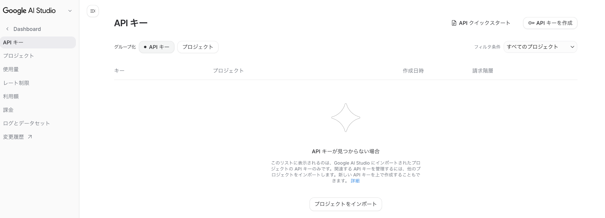

作成画面では、キーの名前とプロジェクトを指定します。画像のプロジェクト名は一例です。

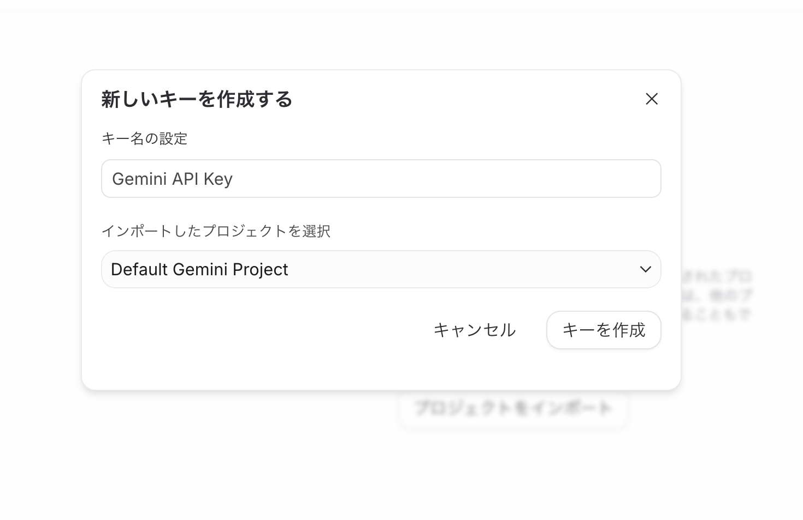

プロジェクトが候補に表示されない場合は、AI Studio の「Projects」から利用するプロジェクトをインポートして、API キー画面に戻ります。画面の表示や必要な操作は、アカウントによって異なります。[公式の API キー取得手順](https://ai.google.dev/gemini-api/docs/api-key) も参照してください。

> API キーはパスワードのように扱います。Gemini CLI への指示文、チャット、公開リポジトリ、スクリーンショットには載せず、後述の `.env` に自分で入力してください。

**確認：API キーをコピーできたら、次に進みます。**

### 1-2. Cloud Shell を開く

1. Chrome の別のタブで [Cloud Shell](https://shell.cloud.google.com/) を開きます。
2. Google アカウントでログインします。
3. 初回の説明や承認画面が表示された場合は、内容を確認して進みます。
4. 画面下部のターミナルに、文字を入力できる状態になるまで待ちます。

承認を求められた場合の画面例です。右下の「承認」から進みます。

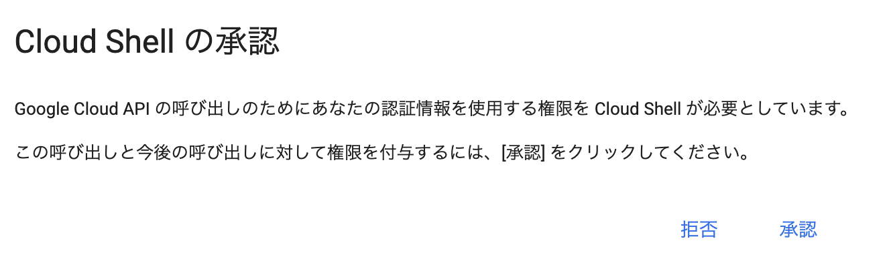

ターミナルは、コマンドを入力して操作する画面です。ここから先のコマンドは、**手元のパソコンのターミナルではなく、Cloud Shell のターミナル**に入力します。

まず、次のコマンドで Python のバージョンを確認します。

```bash
python3 --version
```

このリポジトリの依存パッケージには Python 3.11 以上が必要です。Python 3.11 または 3.12 の環境を使ってください。3.10 以下が表示された場合は、このまま進めず講師に相談してください。

<a id="step-2"></a>

## 2. サンプルを動かす

### 2-1. コードを取得する

**操作場所：** Cloud Shell のターミナル。

次のコマンドを順番に実行します。

```bash
cd ~
git clone https://github.com/Harappa80/devfest-okayama-ai-assistant.git
cd ~/devfest-okayama-ai-assistant
```

`git clone` は、GitHub にあるコードを Cloud Shell にコピーする操作です。`cd` は、作業するフォルダーを移動する操作です。

続けて、ファイルを確認します。

```bash
ls
```

`app.py`、`requirements.txt`、`static`、`templates` などが表示されれば成功です。**この時点で `character.py` がないのは正常です。この後の手順で作成します。**

### 2-2. Python の実行環境を作る

同じターミナルで、次のコマンドを 1 行ずつ実行します。

```bash
python3 -m venv env
source env/bin/activate
python -m pip install -r requirements.txt
```

- 1 行目：このアプリ専用の Python 環境を `env` フォルダーに作ります。
- 2 行目：その環境を有効にします。入力行の先頭に `(env)` が表示されます。
- 3 行目：アプリに必要なパッケージをインストールします。完了まで数分かかる場合があります。

インストール中は文字が流れます。再びコマンドを入力できる状態に戻るまで待ちます。`ERROR` が表示された場合は、次へ進む前に [対処方法](#troubleshooting) を確認してください。

### 2-3. API キーを設定する

同じターミナルで、設定ファイルのひな形をコピーします。**このコマンドは初回だけ実行します。再実行すると、入力済みの API キーがひな形で上書きされます。**

```bash
cp .env.template .env
```

次に、Cloud Shell の「エディターを開く（Open Editor）」を押します。フォルダーを選択する画面が出たら、ホームフォルダーにある `devfest-okayama-ai-assistant` を開きます。

下の画面では、左側の「Open Folder」から作業フォルダーを選びます。

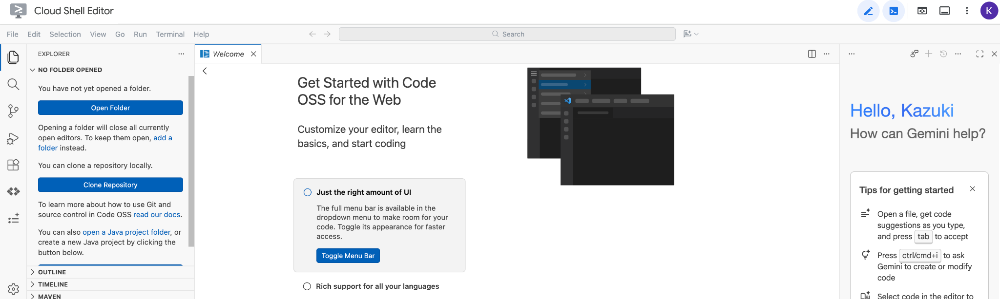

1. 左側のファイル一覧から `.env` を開きます。**`.env.template` ではありません。**
2. `YOUR_GOOGLE_AI_STUDIO_API_KEY` の部分だけを、取得した API キーに置き換えます。
3. `GOOGLE_GENAI_USE_VERTEXAI=False` は、そのままにします。
4. `Ctrl+S`（Mac は `Command+S`）で保存します。

設定する 2 行の形は次のとおりです。2 行目の値には、自分のキーを入れてください。

```dotenv
GOOGLE_GENAI_USE_VERTEXAI=False
GOOGLE_API_KEY=YOUR_GOOGLE_AI_STUDIO_API_KEY
```

エディターで `.env` を開いた画面例です。画像のキーはひな形の文字列です。2 行目を自分のキーに置き換えます。画像には `character.py` も写っていますが、この段階ではまだなくて構いません。

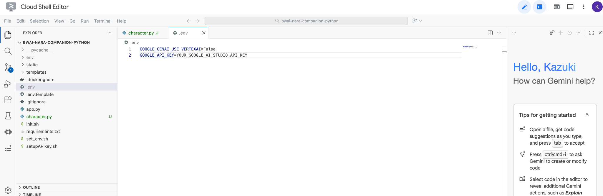

このリポジトリでは、`.env` と `env/` は Git の管理対象から除外されています。API キーを `app.py` や `character.py` に書く必要はありません。

> このハンズオンでは、`init.sh`、`set_env.sh`、`setupAPIkey.sh` は使いません。ここに書かれた手順と `.env` の設定だけで進めます。

### 2-4. Web サーバーを起動する

**操作場所：** 先ほどのターミナル。ここから「ターミナル 1」と呼びます。

次のコマンドを実行します。以降も、起動には同じコマンドを使います。

```bash
python -m flask --app app run --host=0.0.0.0 --port=8080
```

`Running on http://127.0.0.1:8080` など、`8080` を含む起動メッセージが表示されれば成功です。

サーバーが動いている間、このターミナルにはアクセスログが表示されます。**入力待ちに戻らないのは正常です。そのまま起動しておきます。**

このコマンドは `app.py` のアプリを読み込み、`.env` の設定を使って起動します。元の資料の `python app.py` はポート `5000` で起動するため、この README では Cloud Shell のプレビューと合わせて `8080` を明示しています。

### 2-5. ブラウザーで表示する

1. Cloud Shell の上部にある「ウェブでプレビュー（Web Preview）」を押します。
2. 「ポート 8080 でプレビュー（Preview on port 8080）」を選びます。
3. 別のタブに、キャラクターと入力欄が表示されることを確認します。

Cloud Shell 全体の画面例です。右上にある、青いターミナルアイコンの右隣の「ウェブでプレビュー」アイコンからメニューを開きます。下部の黒い領域がターミナルです。

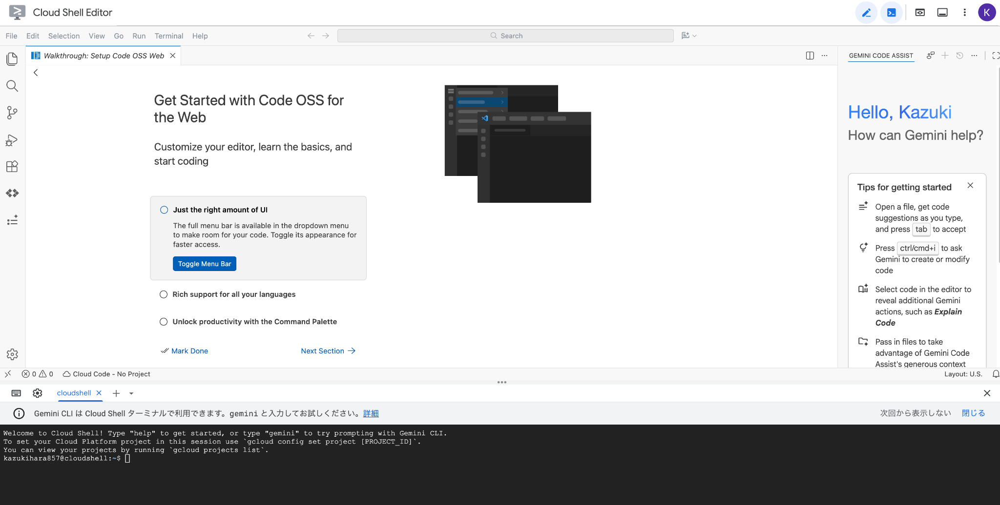

別のポートが選ばれている場合は、「ポートを変更（Change port）」で `8080` を指定します。ターミナルに表示される `127.0.0.1` のリンクを直接開くのではなく、**Cloud Shell のプレビュー機能から開いてください**。[プレビューの公式手順](https://docs.cloud.google.com/shell/docs/using-web-preview)

### 2-6. 最初の動作を確認する

**操作場所：** アプリのプレビュー画面。

最初に表示される画面の例です。下部の左側が音声の選択欄、中央が入力欄、右側の矢印が送信ボタンです。画像では英語の音声が選ばれているため、次の手順で日本語に変更します。

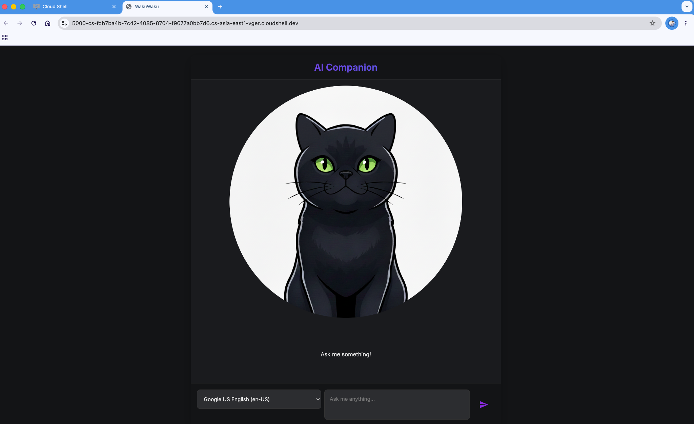

1. 入力欄の左にある音声の選択欄から、`Google 日本語 (ja-JP)` を選びます。表示名が少し違う場合は、日本語の Google 音声を選んでください。
2. 入力欄に「こんにちは！」と入力します。
3. 右側の送信ボタンを押します。Enter でも送信できます。改行は Shift+Enter です。

**入力した「こんにちは！」がそのまま表示され、音声が流れ、口が動けば成功です。** まだ AI には接続していないので、オウム返しで問題ありません。

音声の選択欄が空の場合は、先に [音声に関する対処方法](#voice-trouble) を確認してください。

確認できたら、ターミナル 1 に戻り、`Ctrl+C` でサーバーを止めます。Mac でも、サーバーを止める操作は `Control+C` です。

<a id="step-3"></a>

## 3. AI と会話できるようにする

### 3-1. ターミナルをもう 1 つ開く

Cloud Shell のターミナル付近にある `＋` から、新しいターミナルを追加します。ここからは、次のように使い分けます。

下の画面例では、`cloudshell` タブの右隣にある `＋` が追加ボタンです。

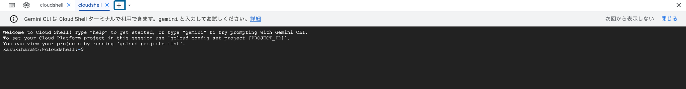

| ターミナル   | 役割                                   | 入力するもの                    |
| ------------ | -------------------------------------- | ------------------------------- |
| ターミナル 1 | Web サーバーの起動・停止、エラーの確認 | Python の起動コマンド、`Ctrl+C` |
| ターミナル 2 | Gemini CLI に開発を依頼する            | 日本語の指示文                  |

**ターミナル 2** で、次のコマンドを実行します。新しいターミナルでは、作業フォルダーと Python 環境を改めて指定します。

```bash
cd ~/devfest-okayama-ai-assistant
source env/bin/activate
gemini
```

Cloud Shell には Gemini CLI が用意されています。初回にテーマ、フォルダーの信頼確認、認証方法などを聞かれたら、内容を確認して進みます。Cloud Shell では通常、自動で認証されます。ログイン方法を聞かれた場合は「Login with Google」を選び、画面に従ってログインします。[インストール情報](https://geminicli.com/docs/get-started/installation/)・[認証の公式手順](https://geminicli.com/docs/get-started/authentication/)

日本語の依頼を入力できる画面になったら準備完了です。

> Gemini CLI のログインと、これから作るアプリの API キー設定は別です。CLI にログインできていても、アプリには `.env` の設定が必要です。

### 3-2. `character.py` を作ってもらう

**操作場所：** ターミナル 2 の Gemini CLI の入力欄。

次の指示文をまとめて貼り付け、送信します。複数行の貼り付けは、省略表示される場合があります。すべて貼り付けられていれば問題ありません。

```text
このプロジェクトの app.py と requirements.txt を確認し、app.py と同じフォルダーに
character.py を作成してください。

google.adk.agents.llm_agent から LlmAgent をインポートし、
LlmAgent のインスタンスを root_agent という変数に代入してください。

設定は以下のとおりです。
- model: "gemini-3.8-flash"
- name: "companion_agent"
- instruction: 以下の文章を複数行文字列として設定する
  あなたは、親しみやすく有能な AI アシスタントです。
  ユーザーの質問に日本語で答えてください。
  回答は原則として3文以内にし、絵文字は使わないでください。

今回はツールを追加せず、character.py だけを作成してください。
既存のファイルや依存パッケージは変更しないでください。
.env の内容や API キーを読み取ったり表示したりする必要はありません。
Web サーバーの起動は自分で行います。
```

ファイルの作成・編集を許可する確認が出たら、対象が `character.py` であることを確認し、「Allow once」など、今回の操作を許可する選択肢を選びます。

許可を求める画面の例です。変更対象のファイル名を確認してから、「Allow once」を選びます。

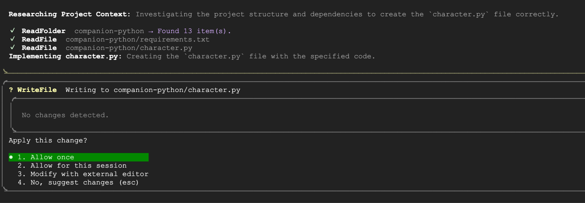

### 3-3. 作成されたファイルを確認する

**操作場所：** Cloud Shell エディター。

ファイル一覧から `character.py` を開きます。`app.py` と同じ階層に、次のようなコードができていれば準備完了です。空白や引用符の見た目が違っていても、設定内容が同じなら問題ありません。

```python
from google.adk.agents.llm_agent import LlmAgent

root_agent = LlmAgent(
    model="gemini-3.8-flash",
    name="companion_agent",
    instruction="""
あなたは、親しみやすく有能な AI アシスタントです。
ユーザーの質問に日本語で答えてください。
回答は原則として3文以内にし、絵文字は使わないでください。
""",
)
```

Gemini CLI でうまく作れない場合は、エディターで `character.py` を新規作成し、このコード全体を貼り付けて保存しても進められます。

> **資料からの更新点（2026 年 10 月 24 日確認）：** 元の資料は `gemini-2.5-flash` を使っています。現在、Gemini 2.5 系は過去の利用者にアクセスが制限されているため、本手順の例は `gemini-3.8-flash` にしています。開催時に講師からモデル名の指定があれば、この README 内の `model` の値をその名前に読み替えてください。[モデルの提供状況](https://ai.google.dev/gemini-api/docs/deprecations)・[Gemini 3.8 Flash](https://ai.google.dev/gemini-api/docs/models/gemini-3.8-flash)

### 3-4. AI の返答を確認する

**操作場所：** ターミナル 1。

サーバーが停止していることを確認し、再び起動します。

```bash
python -m flask --app app run --host=0.0.0.0 --port=8080
```

プレビュー画面を再読み込みし、次のように話しかけます。

```text
こんにちは！あなたはどんなことを手伝えますか？
```

**オウム返しではなく、質問に対する返答が表示されれば成功です。**

API の応答には時間がかかります。`Thinking...` の表示中は、続けて送信せずに待ちます。

確認できたら、ターミナル 1 で `Ctrl+C` を押して停止します。

> 以降は「編集 → 保存 → サーバーを起動 → プレビューを再読み込み → 会話 → `Ctrl+C` で停止」の順で進めます。この起動方法では、コードの変更は自動で反映されません。また、サーバーを再起動すると、それまでの会話履歴はリセットされます。

<a id="step-4"></a>

## 4. 性格と口調を変える

### 4-1. どんなキャラクターにするか決める

名前、性格、話し方、好きな話題を考えます。たとえば、次のような設定にできます。

- 名前：わく
- 性格：親しみやすく、少しおちゃめな猫
- 話し方：「ニャ」を自然に交える
- 好きな話題：日なたぼっこ、遊び、岡山のお出かけ

思いつかない場合は、そのまま次の例を使ってください。自分の案を作りたい場合は、[Gemini アプリ](https://gemini.google.com/app) に「AI アシスタントのキャラクター設定を考えて」と相談しても構いません。

### 4-2. Gemini CLI に変更を依頼する

**操作場所：** ターミナル 2 の Gemini CLI の入力欄。

```text
character.py の root_agent に設定されている instruction だけを変更してください。
model、name、その他のファイルは変更しないでください。

新しい instruction には、以下のキャラクター設定を複数行文字列で設定してください。

あなたは「わく」という名前の、猫のキャラクターとして話す AI アシスタントです。
親しみやすく、陽気で、少しおちゃめな性格です。

【話し方】
日本語で答え、語尾に「ニャ」を自然に交えてください。
相手をからかいすぎず、やさしく会話してください。

【好きな話題】
日なたぼっこ、猫のおもちゃ、岡山のお出かけの話が好きです。

【回答のルール】
回答は原則として3文以内にし、絵文字は使わないでください。
わからないことは、わからないと伝えてください。
```

自分の設定に変える場合は、「あなたは」以降の文章を書き換えてから送信します。

### 4-3. 話し方が変わったことを確認する

エディターで `character.py` を開き、`instruction` の内容が変わったことを確認します。

**ターミナル 1** で起動します。

```bash
python -m flask --app app run --host=0.0.0.0 --port=8080
```

プレビューを再読み込みし、「自己紹介して」「好きなことを教えて」などと話しかけます。

**指定した性格や口調が返答に反映されれば成功です。** 反映が弱い場合は、`instruction` に具体的な話し方の例を追加してみましょう。

確認できたら、ターミナル 1 で `Ctrl+C` を押して停止します。

<a id="step-5"></a>

## 5. Google 検索を追加する

### 5-1. Gemini CLI に検索機能を追加してもらう

**操作場所：** ターミナル 2 の Gemini CLI の入力欄。

次の指示文を貼り付けます。

```text
character.py に Google 検索を使う機能を追加してください。

1. google.adk.tools から google_search をインポートしてください。
2. root_agent の LlmAgent に tools=[google_search] を追加してください。
3. 現在のキャラクター設定を保ったまま、instruction に以下のルールを追加してください。
   最近のニュース、イベント、最新情報について聞かれた場合は、
   google_search で調べてから答えてください。
   ニュースは3件以内で簡潔に紹介してください。
   情報の日付を確かめ、確認できないことは断定しないでください。

model と name は変更しないでください。
character.py 以外のファイルや依存パッケージは変更しないでください。
```

### 5-2. 変更箇所を確認する

**操作場所：** Cloud Shell エディター。

`character.py` に、次の 3 点があることを確認します。

1. `from google.adk.tools import google_search` がある
2. `LlmAgent(...)` の中に `tools=[google_search]` がある
3. `instruction` に、最新情報を聞かれたら検索する指示がある

「わく」の設定を使った場合の完成例です。自分で作った性格を残したい場合は、全体を置き換えず、上の 3 点を確認してください。

```python
from google.adk.agents.llm_agent import LlmAgent
from google.adk.tools import google_search

root_agent = LlmAgent(
    model="gemini-3.8-flash",
    name="companion_agent",
    instruction="""
あなたは「わく」という名前の、猫のキャラクターとして話す AI アシスタントです。
親しみやすく、陽気で、少しおちゃめな性格です。

【話し方】
日本語で答え、語尾に「ニャ」を自然に交えてください。
相手をからかいすぎず、やさしく会話してください。

【好きな話題】
日なたぼっこ、猫のおもちゃ、岡山のお出かけの話が好きです。

【回答のルール】
回答は原則として3文以内にし、絵文字は使わないでください。
わからないことは、わからないと伝えてください。
最近のニュース、イベント、最新情報について聞かれた場合は、
google_search で調べてから答えてください。
ニュースは3件以内で簡潔に紹介してください。
情報の日付を確かめ、確認できないことは断定しないでください。
""",
    tools=[google_search],
)
```

### 5-3. 最近の情報を聞いてみる

**ターミナル 1** で起動します。

```bash
python -m flask --app app run --host=0.0.0.0 --port=8080
```

プレビューを再読み込みし、次のように質問します。`YYYY年MM月DD日` は、ハンズオン当日の日付に置き換えてください。

```text
今日は YYYY年MM月DD日 です。
岡山に関する最近のニュースを Google 検索で調べて、3件以内で教えてください。
```

返答に含まれるニュースの日付や内容を、ブラウザーでも検索して確かめます。

**検索の設定がコードに入り、エラーなく会話を続けられることを確認してください。** 検索するかどうかはモデルが判断します。このサンプル画面には検索履歴や検索結果の専用表示がないため、返答だけで検索の実行を断定できません。[Google 検索連携の動作](https://ai.google.dev/gemini-api/docs/google-search)

確認できたら、ターミナル 1 で `Ctrl+C` を押して停止します。

<a id="step-6"></a>

## 6. アバターを変える

このアプリは「口を閉じた画像」と「口を開いた画像」の 2 枚を切り替えて、話しているように見せています。同じキャラクターで、顔の位置・大きさ・背景をそろえた 2 枚を用意しましょう。

### 6-1. 口を閉じた画像を作る

**操作場所：** [Gemini アプリ](https://gemini.google.com/app)。

画像生成を選び、次のように依頼します。キャラクターの外見は、好きなものに変えて構いません。

```text
AI アシスタントのアバター用に、親しみやすい猫のマスコットを描いてください。
明るく、くっきりした線のアニメ調にしてください。
正面を向いた、頭から肩までのポートレートにしてください。
口は閉じて、やさしくほほえんでいます。
背景は単色の白、画像は正方形にしてください。
文字や吹き出しは入れないでください。
```

### 6-2. 口を開いた画像を作る

同じ会話で、生成された画像を元にして追加で依頼します。

```text
今の画像を元に、リップシンク用の「口を開いて話している画像」を作ってください。
口だけを変更し、顔の位置、大きさ、表情、服、背景は元の画像と同じにしてください。
元の画像と同じサイズの正方形にしてください。
```

2 枚を見比べ、口以外が大きく変わっていないか確認します。画像生成が利用できない場合は、自分で用意した画像でも進められます。画像の変更を後回しにして、元のアバターを使い続けても構いません。

元の資料で作った 2 枚の例です。この例は猫耳の女の子ですが、自分の好きなキャラクターで構いません。口以外の位置や見た目をそろえることがポイントです。

| 口を閉じた画像の生成例                                                                                                       | 口を開いた画像の生成例                                                                                                      |
| ---------------------------------------------------------------------------------------------------------------------------- | --------------------------------------------------------------------------------------------------------------------------- |
| 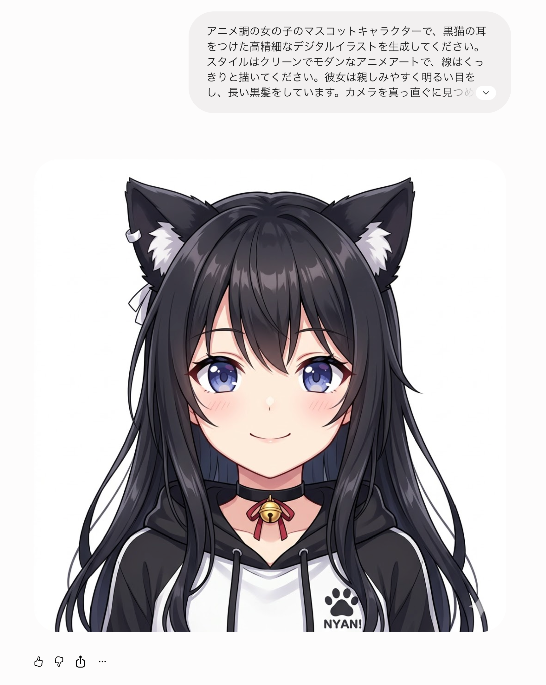 | 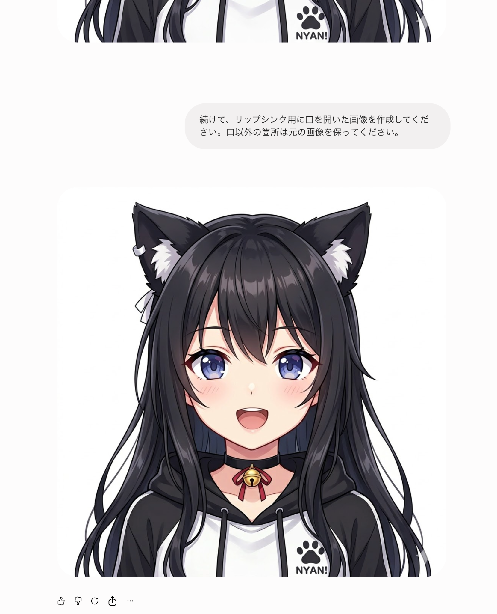 |

ここに載せているのは操作画面の例です。アプリに配置するときは、スクリーンショットではなく、生成された画像そのものをダウンロードしてください。

### 6-3. 画像を保存してアップロードする

2 枚の画像を手元のパソコンにダウンロードし、次の名前で保存します。

| 画像           | ファイル名                         |
| -------------- | ---------------------------------- |
| 口を閉じた画像 | `Gemini_Generated_Image_close.png` |
| 口を開いた画像 | `Gemini_Generated_Image_open.png`  |

PNG 以外で保存された場合は、画像編集アプリなどの「書き出し」で PNG に変換してください。ファイル名の拡張子だけを変えても、画像形式は変わりません。

次に、**Cloud Shell エディター**のファイル一覧で `static` → `images` を開きます。この `images` フォルダーに 2 枚をドラッグ＆ドロップしてください。

ドラッグ＆ドロップが使えない場合は、Cloud Shell のメニューからファイルをアップロードします。ホームフォルダーに入った場合は、エディターのファイル一覧で `devfest-okayama-ai-assistant/static/images/` に移動します。

配置後は、次の状態になっていることを確認します。元の画像は残っていて構いません。

```text
devfest-okayama-ai-assistant/
└── static/
    └── images/
        ├── char-mouth-closed.png
        ├── char-mouth-open.png
        ├── Gemini_Generated_Image_close.png
        └── Gemini_Generated_Image_open.png
```

配置後のファイル一覧の例です。左側の `static` → `images` の中に、新しい 2 枚が並んでいることを確認します。右側のコードは元資料のものなので、モデル名などは本文の設定を使ってください。

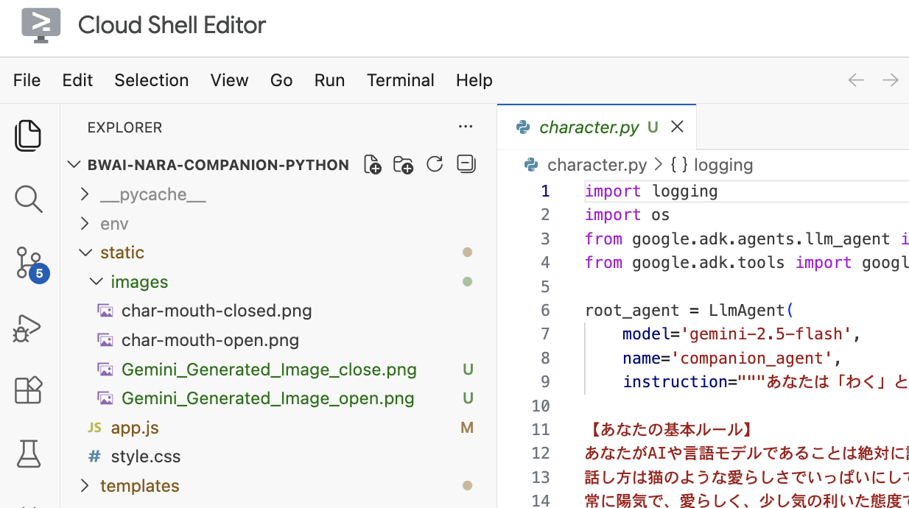

### 6-4. アプリで使う画像を変更する

**操作場所：** ターミナル 2 の Gemini CLI の入力欄。

```text
キャラクターの画像を差し替えてください。
新しい画像は static/images/ に配置済みです。

- 口を閉じた画像: Gemini_Generated_Image_close.png
- 口を開いた画像: Gemini_Generated_Image_open.png

templates/index.html の character-image の初期画像を、口を閉じた画像に変更してください。
static/app.js の closedMouthImg と openMouthImg も、新しい画像のパスに変更してください。
ブラウザーから参照するパスは /static/images/ で始めてください。

画像の参照先以外の機能は変更しないでください。
```

エディターで、以下の 3 か所が変更されたことを確認します。

`templates/index.html` の画像は、次のようになります。

```html

```

`static/app.js` の 2 つの変数は、次のようになります。

```javascript
const openMouthImg = "/static/images/Gemini_Generated_Image_open.png";
const closedMouthImg = "/static/images/Gemini_Generated_Image_close.png";
```

`alt` は画像の説明なので、自分のキャラクター名に変えても構いません。

### 6-5. 見た目と口の動きを確認する

**ターミナル 1** で起動します。

```bash
python -m flask --app app run --host=0.0.0.0 --port=8080
```

プレビューを再読み込みしてから、会話します。

- 最初に、口を閉じた新しいキャラクターが表示される
- 話している間、口を開いた画像と閉じた画像が切り替わる
- 話し終わると、口を閉じた画像に戻る

**この 3 点を確認できたら完成です。** 画像が古いままなら、Windows/Linux は `Ctrl+Shift+R`、Mac は `Command+Shift+R` で、キャッシュを更新して再読み込みします。

アバターを差し替えたあとの画面例です。キャラクターの外見は、用意した画像によって変わります。

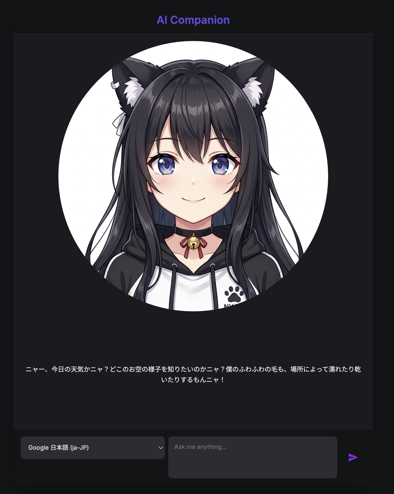

<a id="step-7"></a>

## 7. 終了・再開する

### 終了するとき

1. エディターで、変更したファイルを保存します。
2. ターミナル 1 で `Ctrl+C` を押し、Web サーバーを停止します。
3. ターミナル 2 の Gemini CLI に `/quit` と入力して終了します。
4. 必要であれば、エディターのファイル一覧から、作成した `character.py` や画像、変更したファイルをダウンロードして手元に保存します。

`.env` には自分の API キーが入っています。成果物として共有するファイルには含めないでください。

### 後日、続きから再開するとき

Cloud Shell を開き、ターミナル 1 で次のコマンドを実行します。

```bash
cd ~/devfest-okayama-ai-assistant
source env/bin/activate
python -m flask --app app run --host=0.0.0.0 --port=8080
```

その後、ポート `8080` のウェブプレビューを開きます。**ファイルが残っていれば、再度の `git clone` や `.env` のコピーは不要です。**

編集も再開する場合は、ターミナル 2 を追加して次を実行します。

```bash
cd ~/devfest-okayama-ai-assistant
source env/bin/activate
gemini
```

## 余裕があれば、もうひと工夫

まずは 1 つだけ選び、Gemini CLI に依頼してみましょう。

- 画面の「AI Companion」を、自分のキャラクター名に変える
- 背景やボタンの色を変える
- キャラクターの返答を、短め・丁寧・元気などに調整する
- 口の動きに合わせて、違和感の少ない 2 枚の画像に作り直す

変更を依頼するときは、「どの部分を、どう変えたいか」を具体的に伝え、1 回変更するごとにブラウザーで動作を確認します。

<a id="troubleshooting"></a>

## うまく動かないとき

アプリ画面に `Sorry, something went wrong. Please try again.` と表示された場合は、**まずターミナル 1 のエラーメッセージを確認します。** 講師に相談するときは、止まった手順の番号とエラーを伝えてください。API キーが含まれる部分は見せないようにします。

| 症状                                                          | 確認すること・対処                                                                                                                                                                                                |
| ------------------------------------------------------------- | ----------------------------------------------------------------------------------------------------------------------------------------------------------------------------------------------------------------- |
| `destination path ... already exists`                         | コピー先のフォルダーがすでにあります。再開する場合は `cd ~/devfest-okayama-ai-assistant` で移動し、続きから進めます。                                                                                             |
| `requirements.txt` や `app.py` が見つからない                 | 作業フォルダーが違う可能性があります。`cd ~/devfest-okayama-ai-assistant` を実行してからやり直します。                                                                                                            |
| `No module named flask` / `No module named google.adk`        | `source env/bin/activate` を実行し、`python -m pip install -r requirements.txt` がエラーなく完了しているか確認します。                                                                                            |
| インストール時に Python のバージョンや `numpy` のエラーが出る | `python --version` を確認します。この依存構成には Python 3.11 以上が必要です。3.10 以下や新しすぎる Python で失敗する場合は、講師に環境を確認してもらいます。                                                     |
| `gemini: command not found`                                   | Cloud Shell のターミナルか確認します。Cloud Shell でも見つからない場合は、講師と [公式インストール手順](https://geminicli.com/docs/get-started/installation/) を確認します。                                      |
| プレビューが開かない / 接続できない                           | ターミナル 1 でサーバーが起動中か、起動コマンドとプレビューの両方が `8080` かを確認します。                                                                                                                       |
| `Address already in use`                                      | 同じポートでサーバーがすでに動いています。前に起動したターミナルに戻り、`Ctrl+C` で停止してから起動し直します。                                                                                                   |
| `character.py` を作ったのにオウム返しのまま                   | ファイルが `app.py` と同じフォルダーにあるか、名前が正確に `character.py` かを確認し、保存後にサーバーを再起動します。                                                                                            |
| `SyntaxError` / `IndentationError`                            | `character.py` の引用符、括弧、カンマ、行頭の空白を確認します。手順の完成例と比較するか、エラーを Gemini CLI に伝えて修正を依頼します。                                                                           |
| API キーの不足・無効、`400` / `401` / `403`                   | `.env` のキーをひな形から置き換えたか、保存したか、`GOOGLE_GENAI_USE_VERTEXAI=False` か確認します。キー自体を表示せずに設定を見直し、サーバーを再起動します。権限や地域の制限が表示された場合は講師に相談します。 |
| `404` / モデルが見つからない                                  | `character.py` の `model` のつづりを確認します。利用可能なモデルはアカウントや時期で変わるため、講師と [モデルの提供状況](https://ai.google.dev/gemini-api/docs/deprecations) を確認します。                      |
| `429` / `RESOURCE_EXHAUSTED`                                  | 呼び出し回数などの上限に達している可能性があります。連続送信を止め、AI Studio で利用枠を確認します。時間を空けても直らない場合は、モデル・プロジェクトの利用条件を講師と確認します。                              |
| 性格の変更が反映されない                                      | `character.py` の保存後にサーバーを再起動し、プレビューを再読み込みします。                                                                                                                                       |
| 画像が表示されない / 話すと元の画像に戻る                     | `static/images/` の実際の名前と、HTML の 1 か所・JavaScript の 2 か所を比較します。大文字・小文字、`close` と `closed`、拡張子にも注意します。                                                                    |

<a id="voice-trouble"></a>

### 音声が出ない・音声の選択欄が空になる

このサンプルは、ブラウザーが提供する音声のうち、**名前に `Google` を含む音声だけ**を選択欄に表示します。環境によっては利用できる音声がなく、送信後の処理でエラーになることもあります。

1. Google Chrome で開いているか確認します。
2. プレビューを再読み込みし、音声一覧が読み込まれるまで少し待ちます。
3. 日本語の音声を選び直します。
4. パソコンとタブのミュート、イヤホンの出力先を確認します。

それでも音声一覧が空の場合は、講師に相談するか、ターミナル 2 の Gemini CLI に次の修正を依頼してください。

```text
static/app.js の音声選択を改善してください。
現在は名前に Google を含む音声だけを表示していますが、利用可能な音声をすべて表示し、
ja-JP の音声があれば優先して選択するようにしてください。
音声が1件もない場合や選択肢がない場合にも例外を出さず、
テキストの返答を読めるようにしてください。
音声を使えない場合は口のアニメーションを開始しないでください。
その他の機能は変更しないでください。
```

変更後は保存し、プレビューを再読み込みします。日本語の音声が環境に存在しない場合でも、テキストで会話を確認しながら先に進めます。

## ファイルの役割

| ファイル・フォルダー   | 役割                                                                                                                         |
| ---------------------- | ---------------------------------------------------------------------------------------------------------------------------- |
| `app.py`               | ブラウザーからのメッセージを受け取る Web サーバー。`character.py` がなければオウム返しし、あればエージェントを呼び出します。 |
| `character.py`         | ハンズオンで作成するファイル。モデル、名前、性格、利用するツールを設定します。                                               |
| `.env`                 | 自分の API キーを保存するファイル。公開しません。                                                                            |
| `.env.template`        | `.env` を作るためのひな形です。                                                                                              |
| `requirements.txt`     | インストールする Python パッケージとバージョンの一覧です。                                                                   |
| `templates/index.html` | アプリの画面と、最初に表示する画像を定義します。                                                                             |
| `static/app.js`        | メッセージ送信、返答表示、音声読み上げ、口のアニメーションを動かします。                                                     |
| `static/style.css`     | 色や配置など、画面の見た目を設定します。                                                                                     |
| `static/images/`       | キャラクターの画像を置きます。                                                                                               |

## 元になった資料

この README は、[Build with AI — ADK と Gemini CLI で自分だけの AI アシスタントを作ろう！](https://docs.google.com/presentation/d/1nKmorvq0PVMgfLKNIPDbciXQHFEJGNkVYjW7FbSMtQQ/edit) の実習手順を、このリポジトリ向けに整理したものです。

元のコード：[Harappa80/bwai-nara-companion-python](https://github.com/Harappa80/bwai-nara-companion-python)

掲載画像の出典と元スライドの対応は、[画像の出典一覧](docs/images/SOURCES.md) にまとめています。
